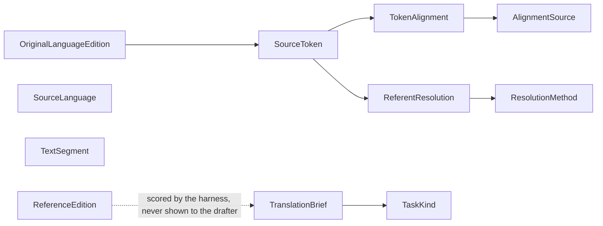
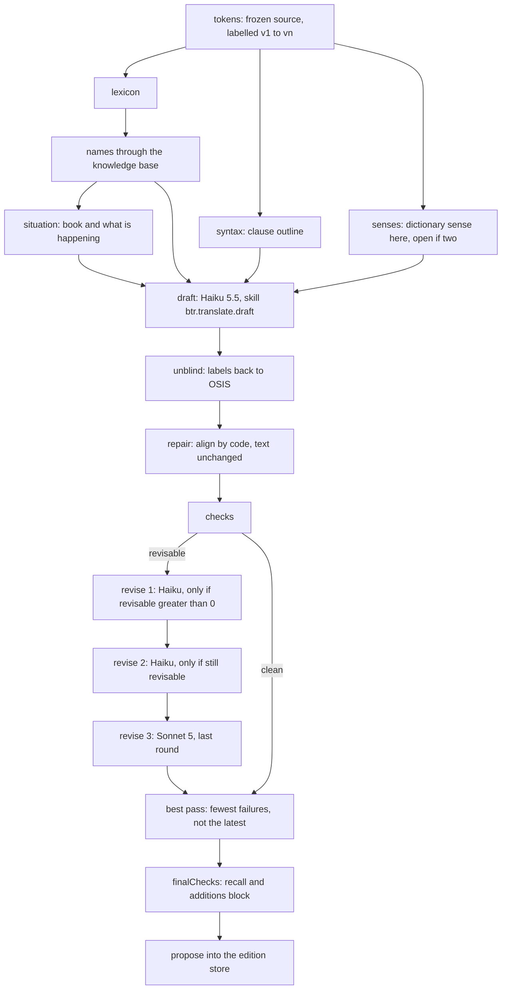
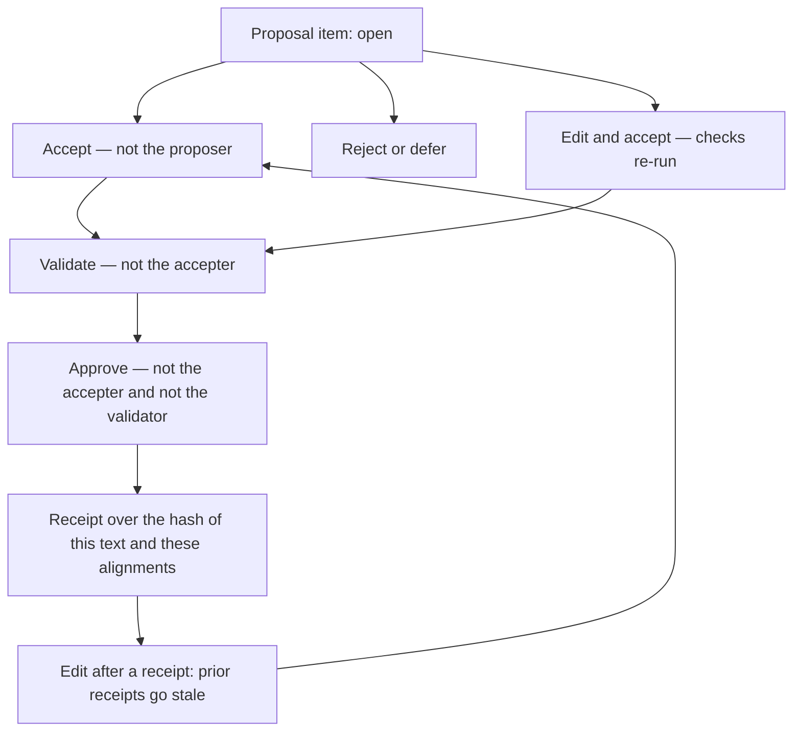

# Auditing the American English translation: ontology, agent harness, tests, and the workbench

This is the procedure behind the American English edition (`rbs`, public id `rbs-en-us`, version `2026-10-19-v2.1`). It is written so a person who was not in the room can check the claim: a verse was drafted from the frozen Hebrew, Aramaic, or Greek, held to an ontology, measured by a pre-registered harness, and is not approved until three different people say so. The companion essay is [A machine translated the Bible from Hebrew and Greek](/writing/translating-the-bible-with-an-ontology). This paper names the steps, the files, the checks, and the screens.

Nothing here is a claim that a human exegete has approved the text. The public edition is a draft. `minimumStatus` on the release is `proposed`. Of 31,085 verses, 27,509 have no blocking check and 3,576 still do. Approval is a receipt on the workbench, and that queue is the point of the last section.

## What an auditor can open

| Surface | What it proves | Where |
| --- | --- | --- |
| Ontology graph | The classes the loop is held to, cut into modules a person can read | [skills.faithnet.io/d/bible-translation/ontology/graph](https://skills.faithnet.io/d/bible-translation/ontology/graph) |
| Scripture knowledge base | Persons, places, concepts, divine names — a separate named graph | [skills.faithnet.io/d/scripture/ontology/graph](https://skills.faithnet.io/d/scripture/ontology/graph) |
| Public text | Every verse, with its stage | [rbs.faithnet.io](https://rbs.faithnet.io) |
| Editions registry | Version, verse counts, checker version, brief | `evaluations/bible-translation/editions.json`, generated from `ontology/bible-translation.data.ttl` |
| Agent plan | The steps one passage actually runs | `packages/translation-orchestration/src/translate-plan.ts` |
| Checks | What fails a verse, and the checker version on the result | `apps/translation-mcp/src/source.ts` (`CHECKER_VERSION`) |
| Test results | Pre-registered arms, quoted numbers, judge name | `evaluations/results/translation/` |
| Review | Accept, validate, approve, change requests | [workbench.faithnet.io](https://workbench.faithnet.io) |

A number in this paper is quoted only when the run, the set, and the judge are named beside it. A run whose judge is unnamed is not a number to compare.

## The English approach, in the terms the registry uses

The source edition is `wlc-ne1904`: the Hebrew and Aramaic of the Westminster Leningrad Codex and the Greek as the public-domain interlinear tables carry them, frozen as one JSON file per chapter under `evaluations/bible-translation/source/tokens/`. Each verse is content-committed. The ingest refuses a re-ingest whose upstream revision moved. A new source revision is a new edition id, not an edit of this one.

The target is American English, variety `en-US`, brief `brief-amer-v1` at `2.2.0`. The working store the models write into is `rbs-v2`. The public name is RBS. The family licence is CC BY 4.0. The acknowledgement on the edition says it is a draft, model-made, from the Hebrew, Aramaic, and Greek.

The unit of work is a pericope, not a fixed window of verses. Section headings in the source markup (`\s1`, and the acrostic `\qa`) cut the Bible into 3,817 chunks, median eight verses. A pericope longer than fourteen verses splits at a paragraph; a one- or two-verse piece joins its neighbour inside the same heading, never across one. Positions only are stored (`evaluations/bible-translation/source/pericopes.json`). The headings' English is not shown to the drafter.

The drafter is shown the source tokens (text, transliteration, parsing, Strong's number), the lexicon entry each number opens, the knowledge-base rendering of each name, the clause outline, the dictionary sense at this occurrence, and the book's attributed setting. It is not shown an English edition of the passage. `get_reference_renderings` is marked for evaluation only. The plan never feeds it to a model step. WEB, ASV, and KJV are read by the graders. chrF is reported per edition and never pooled. A judge of meaning sees a reference answer flagged as reference, not as the target.

The production shape that drafted the second complete Bible is `haiku-haiku-sonnet-3`: Claude Haiku 5.5 drafts and revises the first two rounds; Claude Sonnet 5 runs only the third round, and only on a chunk the checks have not cleared. Referents are off. There is no critic in that shape. The critic was measured, lowered independence from published English, and was taken out until its revision is sent back through the same revise loop. That measurement is in the test section.

Export picks one text per verse: an approved verse wins; otherwise a verse with no invented words; otherwise the fewest blocking checks at that verse; otherwise a model-reviewed verse; otherwise the later proposal. A machine status of `checked` means the checks ran. It does not mean they passed. `model-reviewed` means a second model family accepted a clean draft. It is not approval.

## The ontology, as the Skills graph draws it

Open Bible Translation, Ontology, Graph. The page is the Model lane (classes and relationships), not the Data lane (example records). Scope starts at the domain. "From the Original Languages" is one of thirteen modules. The screenshot below is that page on 20 October 2026, signed in, with that module selected: eleven classes in the module, six of them declared outside it because a class may sit in more than one module when the graph's own rule allows it.

The thirteen modules, in the order the cluster file gives them (`ontology/bible-translation.clusters.ttl`). An auditor who opens a module on the graph should see these classes and no others as members.

| Order | Module on the graph | What an auditor is looking at |
| --- | --- | --- |
| 1 | The Frozen Source | The committed source edition and its segments |
| 2 | Terminology by Sense | A concept is a sense of a word, not the word |
| 3 | The Translation Memory | Approved renderings the next run may read |
| 4 | The Decision Trail | Who decided, over which text |
| 5 | Checks and Critique | Check kinds, severities, the critic's verdict |
| 6 | Original-Language Evidence | Syntax, senses, textual units |
| 7 | The Project and its Policy | Family, source edition, target edition, brief's policy |
| 8 | The Benchmark | Passages, perturbations, pre-registered arms |
| 9 | Blind Review | Assignment, verdict, the act that grows memory |
| 10 | From the Original Languages | Source tokens, alignments, the brief, reference editions the drafter does not see |
| 10 | Workbench: Proposals and Receipts | Proposal, item, revision, decision, commit |
| 11 | Workbench: Work, Changes, Rulings and Release | Work item, change request, chair ruling, release manifest |
| 12 | Analysis-first Translation | Analysis, its validation, the fidelity review |
| 13 | Target Languages | The checker's language profile: function words, numbers, negation |

"From the Original Languages" is the module the English task is named by. Its classes:

The scripture knowledge base is not this graph. It is its own named graph, `urn:skills:context:scripture:kb`, so a context-page count does not walk 85,000 person triples. On 17 October 2026 it held 3,129 persons, 1,007 places (870 geocoded), 5,168 key terms, 45 hand-authored theological concepts whose definition is the rendering rule, 16 divine names, and 34 units. Later concept work raised the authored concept count; the essay states 184, of which 57 were written by hand and 127 were drafted from dictionary domains and then checked by code. Share-alike sources (dictionaries, narrative events) live in a separate named graph and are joined by identifier. The build refuses a source whose licence is not on the allow-list.

What the graph is for, in the English loop: a check does not invent a rule. `names` reads the node's decided rendering. `terminology-consistency` reads the concept's stems, and only on the dictionary sense that denotes the concept. `divine-name` holds only when the Strong's number is beside its partner or is exclusive. A change to a class or a rendering is a change to the source Turtle, then preflight, then a versioned release. The graph on the site is a view of that source. It does not authorize a write.

## The agent harness, step by step

One passage is one `POST /harness/ask` with `task: translate`, an arm, a target edition, and a `runRef` of the form `<edition>/<osis range>`. The driver is `scripts/translate-bible.mts`. It walks pericopes, appends a ledger outside the repository (`~/eval-store/rbs/ledger.jsonl` for the first edition, `~/eval-store/rbs-v2` for the second), and can resume. `--retry-blocking` re-runs only chunks whose last checks still block. The PROV record of the chunk — every activity, its inputs, outputs, model, and token counts — is `~/eval-store/<store>/runs/<ref>.json`. Those words are not committed.

The plan the production arm builds, with analysis and context on and the critic off, is this. A step whose `when` is false is recorded as `skipped` with a null output. It is not deleted.

What each step is, and what an auditor should find in the run file.

| Step | Kind | Who | What must be true |
| --- | --- | --- | --- |
| `tokens` | tool | code | No English gloss in the prompt. Cantillation stripped. Labels are `v1`…`vn`. |
| `lexicon` | tool | code | Strong's entry, and a concept rule when the number is bound to one |
| `names` | tool | code | `v3 t1` plus the knowledge-base IRI. A rendering already decided is `RENDER AS` |
| `situation` | tool | code | Book, attributed authorship, what is happening. Optional: a miss does not stop the chunk |
| `syntax` | tool | code | Clause outline with token numbers. No English of the verse |
| `senses` | tool | code | The sense at this passage. `OPEN` when the dictionary lists two |
| `draft` | model | drafter, Haiku 5.5 | One call. Alignment is one string: `1 bereshit=In the beginning; 4=-` |
| `unblind` | tool | code | Labels mapped back to OSIS. The model never had to emit the reference |
| `repair` | tool | code | Binds names and glosses already in the verse. Does not rewrite the English |
| `checks` | tool | code | Coverage, addition, negation, names, quantities, terminology, recall as observation |
| `revise` / `revise2` | model | reviser, Haiku 5.5 | Only when `revisable > 0`. Same tool description as the draft, so the prefix stays cached |
| `revise3` | model | reviser2, Sonnet 5 | Last round only. A failure that remains blocks the proposal |
| `final` | tool | code | Keeps the pass with the fewest failures, not the last pass |
| `finalChecks` | tool | code | `recallBlocks` on. A verse still identical to a held edition blocks. An addition blocks |
| `propose` | tool | code | One proposal per verse: text, alignments, checks, models, cost, `runRef` |

The revise instruction tells the model that a match with a published Bible is an observation, not an order to paraphrase. Where a check names a concept rule, the word of the key term stays the rule's word. The construction around it may change. That rule was added after John 3:18, where a recall gate had pushed a reviser from "believes" / "saved" into "trusts" / "escapes."

Checks an auditor can re-run without a model, against a stored draft:

| Check | Fails when | Severity on the last gate |
| --- | --- | --- |
| `source-coverage` | A source token is unaligned, and it is not a class English absorbs (article, conjunction, object marker, bare preposition, narrative "and it came to pass") | blocking |
| `addition` | A content word in the English has no source token | blocking on the last checks; revisable before |
| `negation` | A separated negator has no English negation. Adjacent οὐ μή is one. English may distribute one "not" over "or" | blocking |
| `names` | A resolved person or place is not the node's rendering | blocking |
| `quantities` | A number does not compose (fourteenth is 4 + 10, three hundred is 3 × 100) | blocking |
| `terminology-consistency` | A token under a concept, in that concept's sense, misses the rule's stem | major, revisable |
| `divine-name` | A divine-name claim by a Strong's number that is also a common noun, without its partner | blocking |
| recall | A long run shared with a held English edition | observation until the last checks, then blocking if the verse is still identical |

The checker version is stamped on every checks object (`CHECKER_VERSION` in `source.ts`). Two results are compared only inside one version. As of this paper the English whole-Bible release `2026-10-19-v2.1` was cut under the checker the registry records on that release; later checker edits (including the closed-lexicon rule used for Tar Melbene) do not rewrite that release. A re-check is a new file, not an edit of the old one.

Prompt caching is part of the audit, not a performance note. The passage material is the message prefix. The system prompt and that prefix are marked ephemeral on Anthropic. The tool description is identical on the draft and every revision, because tools sit in front of the system in the cache key. `usage.cacheReadTokens` on the activity is the evidence the revision read the prefix from cache. A run that rewrote the tool description and shows zero cache reads failed this check.

Cost, so the shape can be audited against the bill. The strong model drafting every verse was about $0.076 a verse. The second complete draft, cheap model throughout except seventeen long passages and one passage a content filter refused, was about $49 for 31,085 verses, about $0.0016 a verse. The measured production shape before that spend, `haiku-haiku-sonnet-3` on the development set, was $0.0076 a verse, about $236 for the Bible before a retry pass. Those are plan costs on the dev set, not the invoice of the whole-Bible run. The ledger is the invoice.

## The test harness

The harness measures the checker before it measures the model. That order is the audit.

**Floor and ceiling set the rules.** The first development run put a public-domain human translation (the World English Bible) and the interlinear gloss through the checks. The WEB failed a blocking check on 67% of verses. The gloss failed on 80%. The Bibles were not wrong. Five rules were: curly apostrophes, one "not" demanded per Hebrew negator, numbers that did not compose, a divine-name rule that fired on "poor in spirit," and dropped tokens that English absorbs. The rules were tuned until both read 0.99. Only then were model drafts scored. A rule change that is not re-run on the floor and the ceiling is not a finished change.

**Three sets, never pooled.**

| Set | What it is | What it may be used for |
| --- | --- | --- |
| Development | Tune rules and arms. `translate-v1` dev, 55 cases in the runs quoted below | Tuning. Not a quoted quality number |
| Held-out | Written once and locked. `bible-translation-translate-v1-heldout@1`, 73 cases, 458 verses scored | The number that may be quoted |
| Regression | Errors planted in the plan, then checked. The model is not the subject | The checker's catch rate |

A localise arm on a set whose task is `translate` is refused. Graders are one list. A translate smoke that grades only `scope` is a bug, and it happened once, when the durable object's one-run path carried its own grader list.

**Arms, declared before the run.** `control-web` proposes the WEB verse as it stands. It is the ceiling. Its chrF against itself is excluded. `gloss` lays the tables' glosses in gloss order, one alignment per token. It is the floor, and on alignment checks it is the ceiling, because it is aligned by construction. `model-src`, `model-lex`, and `model-mem` are the model variants. Later arms (`haiku-sonnet-revise`, `haiku-haiku-sonnet-3`, `haiku-sonnet-revise-critic`, `haiku-sonnet-revise-ref`) were added as named shapes and measured on dev before any of them became the default. An arm that is not in the arms file is not a result.

**Graders read the proposal, not the first draft.** For a period every deterministic grader read the first `checks` step, so a revise arm was scored on text its revisions had replaced. `tr-dev-prod-1` then reported coverage 0.64 on chunks whose proposal had `blocking: 0`. Graders now read `proposal.checks` first. A test pins it. `scripts/translation-regrade.mts <id>` re-runs the deterministic graders over a stored result and recomputes summaries. Judge verdicts are kept. An auditor who finds a coverage number from before that fix should ask for the regrade file.

**Planted errors price a rule change.** Regression v2 planted 839 cases. Three new kinds scored 0 of 256 on the first reading because the catch map had no entry for them, not because the checker missed them. The map is now total, held by a harness test. Re-read under that map: added theological term 1.00 (118/118), dropped emphatic 1.00 (30/30), flipped person 0.80 (89/111). Overall 0.93 (780/835, four excluded). Flipped person stays the known gap: there is no person–number check. The essay's later statement that the catch rate held at 0.93 through checker .17 is the number to re-check against `tr-regression-v3-1` if a rule has moved since.

**The held-out number, with its judge.** Run `tr-heldout-prod-1`, set `bible-translation-translate-v1-heldout@1`, judge Claude Sonnet 5.5, tier strong, one run per arm, 17 October 2026.

| Arm | n | Fidelity checks | Coverage | Independence from published editions | Fidelity judge | Fluency judge | chrF vs WEB |
| --- | --- | --- | --- | --- | --- | --- | --- |
| WEB, the ceiling | 67 | 0.987 | — | 0.693 | — | 0.676 | — |
| Gloss, the floor | 66 | 0.971 | 0.916 | 0.823 | — | 0.619 | 0.766 |
| Haiku drafts, Sonnet revises | 66 | 0.930 | 0.867 | 0.962 | 0.780 | 0.764 | 0.692 |

A second judge, gpt-5.5, read the same stored runs: fidelity 0.792 against Sonnet 5.5's 0.780. Fluency rankings agreed that the draft sat above the WEB. The two judges are not pooled.

The critic arm, measured on dev after the regrade, raised chrF against the WEB by 0.077 and lowered independence by 0.107, both intervals clear of zero, at 2.4 times the cost. That is why it is not in the production shape. The referent pass, measured as `haiku-sonnet-revise-ref`, moved nothing that cleared zero, at 2.8 times the cost. It stays optional.

**What the harness refuses.** A repeat that is not a fresh context. An arm without the gateway off, because a gateway profile was cutting answers and swapping the judge. A result with no verdict and no `failureCause`. A planted kind with no catch-map entry (it would score 0 forever). Comparing two checker versions as if they were one.

## The workbench

No verse is approved by the harness. The workbench at workbench.faithnet.io is the collaborative review. The edition under review is a setting, not a hard-coded string: `GET /workbench/edition` returns the edition id and the version. For the public English text that is `rbs-v2` and `2026-10-19-v2.1`. A proposal whose `runRef` is from another edition is marked, not mixed in.

A run is synced into the queue by `scripts/workbench-sync-run.mjs` against the store that produced the release. Each verse becomes a proposal item. The item carries the text, the alignments, the checks, the arm, the models, and the run. The reviewer sees the source beside the draft.

Three different people take a verse to approved. The server holds the rule. The buttons in the review pane only offer the act the server will accept.

| Act | Who may | Who may not | What is written |
| --- | --- | --- | --- |
| Accept | A reviewer who did not propose it | The proposer, when the proposal was not a machine `runRef` | `ReviewDecision`, disposition `accept` |
| Edit and accept | The same | The same | New text; checks run again; the old accept stays on the record |
| Validate | Reviewer, exegete, chair, or translation analyst | The person who accepted this verse | disposition `validate`. Refused while evidence is stale |
| Approve | Chair or exegete | Anyone who accepted or validated this verse | disposition `approve` |
| Reject, defer | A reviewer | — | The verse stays out of the release |
| Revert | A person with the role | — | A compensating revision and a `revert` receipt. Nothing is deleted |

A receipt is over a hash of the exact text and alignments. An edit after approval makes every earlier receipt visibly stale. The chair can see that. Undo is not a delete.

**Ask, beside the verse.** A reviewer can ask a stronger model whether the verse is wrong or the checker is. The answer comes back as one of: accept, edit and accept, reject, defer, or file a change request. The model is named beside the answer. The button does the act. It does not apply a knowledge-base change by itself.

**Change requests.** A finding against a rule, a name, or the memory is a `ChangeRequest`: the verse, the check, the proposed change. The proposer does not accept it. The approving role is data on the kind (or the chair). Accepted is not applied. Applying it means editing the ontology source, passing preflight, and shipping a release whose changelog names the findings it closes. The skills text, the checker's language profile, and the plan are regenerated from that source. The release is measured on the same pre-registered set as the one before it. A release with no measurement is not a release.

The worked example already in the essay is the ruling on Ἰουδαῖοι in John: "the Jews," never "the Jewish leaders," never "the Judeans," with a note where the authorities are meant. That ruling is a record on the concept. Checker .14 holds drafts to it. The verses of the first draft that had chosen otherwise are listed for revision. An auditor should find the ruling, the checker version, and the verse list, and should not find a silent string replace.

**Release.** The chair records a `ReleaseManifest`: version, scope, books, verses considered, verses shipped, verses held back, blocking count, check-clean count, decision base, brief, checker version. `scripts/build-editions-registry.py` projects that into `editions.json`. The explorer, the landing page, and the workbench read that file. They do not each keep a version constant. For English today the manifest says version `2026-10-19-v2.1`, scope whole, 31,085 verses, 3,576 blocking, 27,509 check-clean, minimum status `proposed`.

## A checklist

1. Open the graph URL above. Confirm the module "From the Original Languages" lists `SourceToken`, `TokenAlignment`, `TranslationBrief`, and `ReferenceEdition`.
2. Open one pericope run file. Confirm `tokens.prompt` contains no verse of a published English Bible, and that `get_reference_renderings` is not an input of `draft`.
3. Confirm the proposal's `checks.checkerVersion` matches the release manifest's checker version, or that a later re-check is a separate file.
4. Confirm `final` kept the pass with fewer failures when a later revise got worse. The step output says which candidate won.
5. Confirm the last checks carry `recallBlocks`, and that a verse still identical to a held edition is blocking.
6. Confirm the held-out table above against `evaluations/results/translation/` for `tr-heldout-prod-1`, judge Sonnet 5.5, and that the gpt-5.5 reading is a separate file.
7. Confirm the regression catch map has an entry for every planted kind, and that flipped person is still reported near 0.80 rather than silently dropped.
8. On the workbench, confirm the header names `2026-10-19-v2.1` and edition `rbs-v2`. Accept a verse as one person, validate as a second, and confirm the first person cannot approve it.
9. Edit an accepted verse and confirm the earlier receipt is marked stale.
10. File a change request and confirm the proposer cannot accept it, and that "accepted" does not change the ontology until a release is cut and measured.

If any of those fail, the edition's stage on the public page is the honest one: a draft, with the open check named beside the verse.
