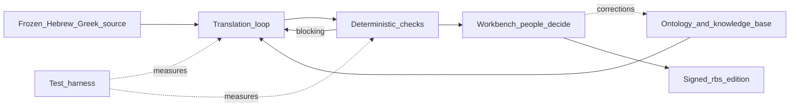

# A machine translated the Bible from Hebrew and Greek. The hard part was making sure it didn't cheat.

Ask a large language model to translate John 3:16 from the Greek and it will give you a beautiful sentence in about a second. It will also, almost certainly, give you the sentence it has read ten thousand times in English Bibles — not a translation of the Greek in front of it, but a memory of what English Bibles say. For most purposes nobody minds. For a new edition of Scripture that claims to come from the source, it is the whole problem.

This is the story of how we built a system that translates the Bible from the original languages into a new American English edition (we call it `rbs`), why a model on its own could not do it honestly, and what it took instead: an ontology that describes the text, a translation loop that is held to that ontology, a test harness that measures the loop before it trusts it, and a workbench where people decide. Each piece exists because the job is genuinely hard. And the shape of the solution is not about the Bible at all.

## Why this is a tough job

Three things make Scripture translation unforgiving in a way most AI tasks are not.

**You cannot grade it against the answer key.** With most translation you check the output against a good human translation. Here the "good human translations" are exactly what the model must not copy. If you score the machine on how close it gets to the King James or the Berean Standard Bible, you are training it to recite. We needed a way to measure a translation against the *source* it came from — every Hebrew and Greek word accounted for, every negation carried, every number right, every name resolved to the right person — without ever rewarding resemblance to published English.

**Consistency has to hold across 31,000 verses and a thousand years of text.** "Judas" names six different men. "Jesus" and "Joshua" are one Greek word. The Hebrew word *ruach* is "wind" in one verse, "breath" in another, "Spirit" in a third, and "sides" of a building in a fourth. A translator — human or machine — working one chapter at a time has no way to keep these straight unless something outside the chapter remembers.

**Every choice has to be explainable.** A reader of a new edition is entitled to ask: why does this verse read differently from the others I know? "The model preferred it" is not an answer. The answer has to be a reason — a rule about a word, a decision about a name, a reading of the text — that a person made, recorded, and can revisit.

A language model has none of this by nature. It has fluency and memory. The system around it has to supply the rest.

## The approach, in one picture

Four parts. The **ontology** says what exists in the text and how it must be rendered. The **translation loop** drafts from the source under those rules and is sent back when a check fails. The **test harness** measures the loop and the checks themselves, with a floor and a ceiling, before any number is believed. The **workbench** is where people review, decide, and correct — and their corrections flow back into the ontology, not into a pile of notes.

## Part one: the ontology — describing the text once, so everything else can be held to it

An ontology is a formal description of a domain: what kinds of things exist, how they relate, what values a field may take, and the individual things themselves. Ours sits on the same foundations the rest of Agentic Primitives uses — W3C PROV-O for who did what, DOLCE for the difference between a *description* (a rule that should hold) and a *situation* (what actually happened), P-Plan for plans with steps — and adds a scripture layer on top.

What is in it today:

- **Every person, place and being in the Bible as a node, not a name.** 3,129 persons with kinship and period; 1,007 places, 870 of them on a map; 477 narrative events with their participants; 78 collectives and 843 memberships. Built from open scholarship (STEP Bible, OpenBible, the Theographic project) and kept under their licences. The Judas who betrayed Jesus is one node in all four Gospels; the patriarch Judah is another. A rendering is a row on the node — so when a second target language comes, it adds rows, never nodes.
- **Every Hebrew and Greek word the source uses as a key term**, 5,168 of them, each opening a lexicon entry.
- **Fifty theological concepts whose definition is itself the rendering rule.** "Eternal life, never everlasting, in John and the letters." "Baptize, never immerse, in the running text." "The referent decides the capital: Spirit, spirit, wind." These are decisions a person wrote down, with a rationale and a citation.
- **God, the Son and the Holy Spirit as referents**, with the sixteen divine names as *forms* of them. יהוה becomes "the LORD" and אֱלֹהִים becomes "God" because those are two renderings of one node, not because a string matched.
- **The translation brief as a typed norm**: what the drafter may see, what it must never see, how gender language, group names and deity pronouns are handled — with a digest, so a run can say which version of the brief it ran under.

The discipline that makes this more than documentation: the skills the agent runs, the rules engine, the controlled vocabularies in the code, the policy register a theologian reads, and the plan the runtime executes are all *generated from* or *validated against* the ontology. Change the rule for a concept and the skill text changes, the checker changes, and the register changes — with a build that fails if any of them drift. One description, many projections.

## Part two: the translation loop — drafting from the source, held to the rules

The loop runs on one pericope (a natural unit of text) at a time, as a declared plan of steps. Every step is recorded as a provenance activity — inputs, outputs, model, cost — so a run is a graph you can query, not a log you search.

1. **Tokens.** The frozen Hebrew or Greek for the span: each word with its parsing and its Strong's number. Frozen means content-committed; the system refuses to re-ingest a source whose upstream edition moved.
2. **Lexicon and names.** For each word, its lexicon entry — and where the ontology has a concept rule, a divine-name convention or a unit value for it, that rule rides along. For each name, the node it resolves to and the rendering already decided for it.
3. **Draft.** The model is shown the tokens, the lexicon, the names and the brief. It is *not* shown any English Bible, and it is not told which passage this is. It returns the English and an alignment from every source word to the words that render it.
4. **Checks.** Deterministic code: is every source word accounted for? Was every negation carried? Are the numbers right, in a system that knows "three hundred" is 3 × 100 and "fourteenth" is 4 + 10? Does every name match the node's decided rendering? Is a word under a concept rule rendered with the rule's stem? Is there English with no source word behind it? And, separately, how much of the output coincides with published editions — measured, reported per edition, and never rewarded.
5. **Revise.** Only when a check blocks. The model receives its own draft and the failing checks, and tries again, up to three rounds — a cheaper model for the first two, a stronger one for the third.
6. **Propose.** One proposal per verse into the edition store, carrying its alignments, its checks, which models drafted and revised it, and the run it came from.

The economics matter, because a Bible is 31,102 verses. A strong model drafting everything costs around $0.076 a verse. The shape that ships — a small model drafts and revises, a large model only on the third round — measured equal on every grader at $0.0076 a verse. The whole Bible for about the price of a nice dinner. That number is only safe because the checks, not the model, are what guarantee the floor.

## Part three: the test harness — measure the measurer first

Here is the part most AI projects skip, and the part that found every important mistake we made.

**The checker was wrong before the model was.** The first time we ran a respected public-domain human translation (the World English Bible) through our checks, 67% of its verses failed a blocking check. The Bible was not wrong; five of our rules were. Apostrophes came in two shapes. Our negation rule wanted one "not" per Hebrew negator, where English distributes one over "or." Our number rule could not compose. A rule that flagged "spirit" as a divine name fired on "poor in spirit." We fixed the rules until the human translation and the interlinear gloss both passed at 0.99 — and only *then* did we look at what the model produced.

**A planted-error suite prices every rule change.** 580 passages with a known error deliberately inserted — a dropped clause, a flipped negation, a swapped speaker, an added theological term, a changed number. The checker's catch rate per kind (0.94 overall today) is reported on every change, so loosening a rule to stop a false alarm shows exactly what it stopped catching. Two kinds got worse when we fixed the pronoun rule. We know which two.

**Experiments are pre-registered and never pooled.** A development set to tune on. A held-out set written once and locked, so it can be quoted. Arms declared in advance — the human translation as the ceiling, the word-for-word gloss as the floor, and the model variants between them. Deterministic graders first; a model-as-judge afterwards, with the judge's identity named on every number, because three judges read the same verses three different ways. Paired comparisons with confidence intervals. A run that fails for a reason that is not the agent's fault — a tool outage, a judge without a key — is recorded as such and kept out of the agent's score.

**And the harness changed the system, not just the score.** Jonah went from one clean chunk in six to six in six when the revise pass was added. Two verses of John 3 found two checker gaps — an ordinal adverb read as a number; an "except" read as a missing "not" — and both became tests. The held-out numbers we quote today: fidelity checks 0.93, source coverage 0.87, independence from published editions 0.96. We quote them with the judge's name attached.

## Part four: the workbench — where people decide, and decisions become data

No verse of `rbs` is approved by a machine. The workbench at workbench.faithnet.io is where a review team reads proposals verse by verse, each with its source, its checks, which model drafted it and which revised it, and a per-verse receipt of who decided what. Three people decide; disagreements go to a chair; every decision is a signed record against the exact text it approved, so an edit after approval makes the approval visibly stale.

Two things make it more than a review queue.

**Ask and Do.** A reviewer facing a verse with three blocking checks can ask a stronger model to explain, in plain language, whether the verse is wrong or the checker is. The answer comes back with a recommendation — accept, edit, reject, or *file a change request against the rule* — and a button that does it. The model that answered is named beside the answer. When the recommendation is "the checker is too broad here," it lands on a backlog that an administrator works off, with the verse, the check and the proposal as evidence. The review surface feeds the ontology.

**Corrections flow upstream.** A reviewer who corrects a name rendering, adds a note about a known ambiguity, or rules on a textual variant is writing a row in the knowledge base, through a path with its own preflight. The next run of every verse that touches that node reads the correction. The loop closes through the ontology, not through someone's memory of what was decided in a meeting.

## What is next, honestly

The system described above drafts from morphology and a lexicon. It does not yet see syntax, and it resolves senses by word rather than by meaning — which is why the Hebrew *ruach* still occasionally trips a rule meant for "Spirit" when the text means "sides." The next stage, in progress, moves the ontology to the centre of the draft itself: a structured analysis of each span — clauses, who does what to whom, which sense of each word, who is speaking, every genuinely open reading recorded as a candidate with its evidence — validated against the ontology *before* any English is written, and the English generated from the analysis. Alongside it, an attributed interpretation graph: what scholars have said about this passage, who said it, when, on what evidence, so that a reviewer can trace a translation choice to a source-language span and a specific argument. The open scholarship to feed it exists — UBS's open dictionaries, Clear's syntax trees, Aquifer's entity annotations, public-domain commentaries — and each enters under its own licence, in its own graph.

Nothing of `rbs` has yet passed a human exegete. That is the point of the workbench, and the reason the numbers above are the checker's numbers and not a claim about the translation.

## Why this is not about the Bible

Strip the Scripture away and look at the shape.

A task where the obvious metric rewards the wrong behaviour. A domain where consistency must hold across a corpus far larger than any one context window. A requirement that every output be explainable to someone with the standing to overrule it. A cheap model that is good enough *if* something else guarantees the floor. A need to measure the measurement before trusting it.

That is clinical decision support. It is regulatory filings. It is contract review across a thousand agreements, financial reconciliation, grant writing against a funder's rules, incident response under a runbook. In every one of them the model is the easy part, and the hard part is the same four things: a single description of the domain that everything binds to; a loop held to that description by checks that run outside the model; a harness that measures the loop and the checks against a floor and a ceiling before quoting a number; and a place where people decide, whose decisions become data the next run reads.

That is what Agentic Primitives is. The Bible is the example where the thing being measured is a sentence of Scripture — which makes both the power of the approach and its limits today unusually easy to see.

`#AgenticPrimitives #Ontology #BibleTranslation #AIEvaluation #KnowledgeGraph #TrustworthyAI`
